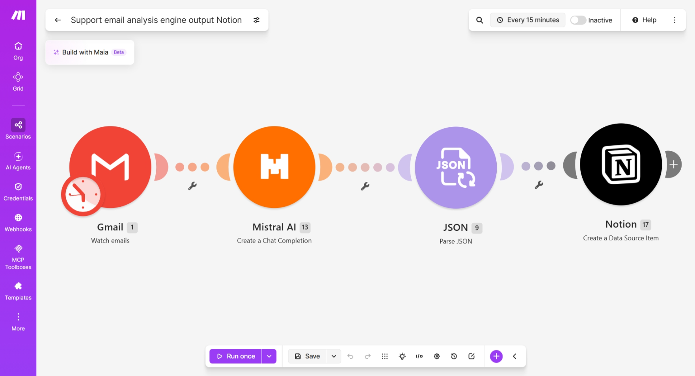

# Support Email Analysis Engine (output: Notion)

A [Make.com](https://www.make.com) scenario that reads incoming customer support emails, uses an AI model (Mistral) to extract the key information (customer, order, issue type, urgency, requested action...), and logs each email in a Notion database.

Other versions of this scenario:
- [Google Sheets](https://github.com/phillarr/Support-email-analysis-engine-output-Google-Sheets)
- [Excel](https://github.com/phillarr/Support-email-analysis-engine-output-Excel): uses a Mistral agent and also extracts `CustomerSince`

▶️ **Video tutorial:** [watch on YouTube](https://www.youtube.com/watch?v=1S-2nc5b0sk)

[](https://www.youtube.com/watch?v=1S-2nc5b0sk)

## The scenario



```
Gmail (new email) ──► Mistral AI (extract as JSON) ──► Parse JSON ──► Notion (create item)
```

## What it does

1. **Watch new emails** (Gmail): checks your inbox for new messages.
2. **Analyze the email** (Mistral AI, `mistral-medium-latest`, JSON mode): sends the subject, sender and body to the model. The model only extracts what is explicitly written, keeps the original wording, and returns `null` for missing fields:
   - `CustomerName`: a name written in the email body (not taken from the email address)
   - `OrderNumber`: an order, reference or ticket number
   - `TrackingNumber`: a shipment tracking number
   - `IssueType`: `delivery`, `billing`, `product`, `refund` or `other`
   - `RequestedAction`: what the customer explicitly asks for
   - `UrgencyLevel`: `high`, `medium` or `low`
   - `ProductMentioned`: the main product mentioned
3. **Parse JSON**: turns the model's reply into structured data.
4. **Create item** (Notion): adds one page per email to your database.

> **The AI can make mistakes.** It can mix up an order number and a tracking number, pick the wrong issue type or misjudge urgency. Use the database to sort and prioritize, but check the original email before answering the customer.

## Requirements

- A Make.com account (the free plan is enough to try it)
- A Gmail account
- A Mistral AI API key ([console.mistral.ai](https://console.mistral.ai))
- A Notion workspace

## Notion database setup

Create a database with these properties:

| Property         | Type  | Filled with                |
|------------------|-------|----------------------------|
| CustomerName     | Title | `CustomerName`             |
| Timestamp        | Date  | Date of processing         |
| OrderNumber      | Text  | `OrderNumber`              |
| TrackingNumber   | Text  | `TrackingNumber`           |
| IssueType        | Text  | `IssueType`                |
| RequestedAction  | Text  | `RequestedAction`          |
| UrgencyLevel     | Text  | `UrgencyLevel`             |
| ProductMentioned | Text  | `ProductMentioned`         |

## Installation

1. Download [`Support email analysis engine output Notion.blueprint.json`](Support%20email%20analysis%20engine%20output%20Notion.blueprint.json).
2. In Make, create a new scenario, open the **⋯** menu, choose **Import Blueprint** and select the file.
3. Reconnect each module to your own accounts:
   - **Gmail**: add your connection.
   - **Mistral AI**: add a connection with your API key.
   - **Notion**: add your connection, then pick **your** database and check the field mapping.
4. In the **Parse JSON** module, rebuild the data structure if Make asks for it.
5. Click **Run once** and send yourself a test email, for example:
   > Hello, I ordered a pair of headphones (order #A-58213) but the tracking number 1Z999AA10123456784 hasn't moved in a week. Can you send a replacement? Thanks, Maria Lopez
6. Turn on scheduling when you are happy with the result.

## Customizing

- **Fields and categories**: edit the extraction rules and allowed values in the Mistral system prompt.
- **Model**: any Mistral model works. A lower `temperature` (for example `0.2`) gives more consistent extraction.
- **Notion views**: use Select properties for `IssueType` and `UrgencyLevel` to group and filter your board.
- **Email filter**: limit the Gmail trigger to your support inbox or a label.

## Privacy and security

- **Email contents are sent to Mistral AI** for processing. Only use this with mailboxes whose data you are allowed to share with a third-party AI provider.
- **API keys and OAuth tokens stay in your Make connections** and are never exported in the blueprint.
- **Emails are untrusted input.** Someone could write an email designed to trick the AI (prompt injection) and fill the database with misleading data.
